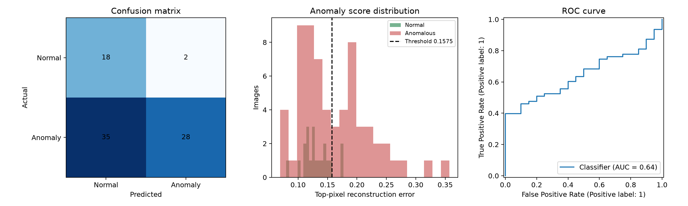
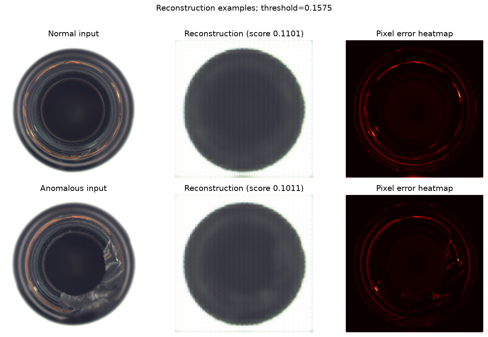

# MLOps Summative Assignment Report

**Student Name:** [Enter your name]  
**Video Recording:** [Add your public video link; maximum 3 minutes, camera on, full screen shared]  
**GitHub Repository:** [Summative-MLOP](https://github.com/Mukasa-E/Summative-MLOP)  
**Deployed Application:** [rodamanomaly.centralindia.cloudapp.azure.com](https://rodamanomaly.centralindia.cloudapp.azure.com)

> **Scope note:** The supplied report template is titled for a reinforcement-learning assignment and asks for DQN, REINFORCE, PPO, rewards, and episodes. This repository implements the separate MLOps summative assignment: image anomaly detection and deployment. It does not contain a reinforcement-learning agent, so those RL-specific results are not applicable and are not represented as implemented.

## 1. Project Overview

This project detects manufacturing defects in product images using the MVTec Anomaly Detection (AD) dataset.  
It trains a convolutional autoencoder on defect-free bottle images and identifies unusual images by reconstruction error.  
The pipeline includes image acquisition and preprocessing, training, threshold selection, evaluation, prediction, and retraining.  
A Flask API and Streamlit interface expose prediction, visualizations, model health, and an upload-triggered retraining workflow.  
Docker Compose packages the services, while Caddy provides HTTPS and an authentication gate for the public Azure-hosted demo.

The use case is visual quality inspection: a user submits a product image, receives a normal/anomalous result, and can inspect the reconstruction and pixel-error heatmap. The model learns the appearance of normal items rather than requiring examples of every possible defect. It is an educational prototype, not a validated safety or production inspection system.

## 2. Environment, Data, and Pipeline Design

### Environment and data source

The dataset is the **bottle** category of MVTec AD. Training uses images from `train/good` and images saved under the normal-upload folder by the retraining workflow. Evaluation uses the category's mixed normal and defective test images. The processed test set contains 83 images: 20 normal and 63 anomalous. The saved training array contains 212 images: 209 from MVTec `train/good` and three additional images stored in the normal-upload folder. Images in that folder are treated as normal by the pipeline, so upload labels and content should be checked before retraining.

The pipeline resizes images to 224 × 224 pixels using Lanczos resampling, converts them to RGB, scales pixel values to [0, 1], and stores the resulting arrays as float32. The model receives an image tensor in channel-first form. This is image data, not a tabular feature vector.

### Inputs and derived observations

There is no RL agent or environment observation. The equivalent model inputs and derived evidence are:

| Input / derived signal | Description | Source | Encoding / type | Range |
|---|---|---|---|---|
| Product image | Image submitted for prediction or used as normal training data | User upload; MVTec AD dataset | RGB image, converted to NumPy float32, H × W × 3 | Pixel values [0, 1] after preprocessing |
| Reconstructed image | Autoencoder's reconstruction of the submitted image | Derived from model inference | Float tensor, C × H × W, displayed as RGB | Sigmoid output [0, 1] |
| Pixel-error map | Per-pixel mean squared difference between input and reconstruction | Derived from input and model output | 224 × 224 floating-point array | Non-negative; no fixed upper bound beyond the normalized pixel-error limit |
| Anomaly score | Mean error among the highest-error 0.5% of pixels | Derived from pixel-error map | Scalar float | Non-negative |
| Decision threshold | 90th percentile of held-out normal validation scores | Derived during training/retraining | Scalar float stored in `models/threshold.npy` | Non-negative |

The uploaded image is the only direct sensor-like input in this implementation. The demo accepts files through a browser; no physical camera or manufacturing-line sensor is connected.

### User actions and outputs (instead of an RL action space)

The interface offers user-initiated operations rather than discrete or continuous agent actions:

1. Submit one image for prediction.
2. View model health and available data visualizations.
3. Upload a batch of normal images to the category's upload folder.
4. Trigger retraining using the original normal training images plus uploaded normal images.

Prediction returns a binary class (`0 = normal`, `1 = anomalous`), score, threshold, confidence-like distance from the threshold, and optional reconstruction/heatmap imagery. The displayed confidence is a score-distance heuristic, not a calibrated probability.

## 3. Model and Learning Objective

The model is a convolutional autoencoder trained from scratch on normal images only. Its encoder uses 3 × 3 convolution layers with ReLU activations and channels 3 → 32 → 64 → 128, each downsampling by a factor of two. The decoder uses transposed convolutions to reconstruct the 224 × 224 RGB input, ending with a sigmoid output.

Training minimizes mean squared reconstruction error:

\[
L_{\mathrm{MSE}} = \frac{1}{N \cdot H \cdot W \cdot C}
\sum_{n,h,w,c}(x_{n,h,w,c} - \hat{x}_{n,h,w,c})^2
\]

Adam is used for optimization. A seeded 80/20 split of normal training images supplies the fit and validation sets. Early stopping monitors validation loss, with a patience of three epochs and restoration of the best validation weights. The maximum training duration is ten epochs. The anomaly score emphasizes localized differences by averaging the largest 0.5% of per-pixel errors. The classification threshold is the 90th percentile of the held-out normal validation scores.

There is no reward function: the project is supervised only for held-out evaluation and unsupervised/one-class for fitting. The learning objective is reconstruction loss, not cumulative reward. DQN, REINFORCE, PPO, policy entropy, and episodes-to-convergence are therefore not applicable.

## 4. Implementation and MLOps

| Setting / component | Implementation |
|---|---|
| Model | Convolutional autoencoder; normal-only training |
| Maximum epochs | 10 |
| Learning rate | 0.001 |
| Optimizer / loss | Adam / mean squared error |
| Batch size | 32 |
| Fit / validation split | 80% / 20%, `random_state=42` |
| Early stopping | Validation loss, patience 3; restore best weights |
| Threshold | 90th percentile of normal validation anomaly scores |
| Model artifacts | `models/autoencoder_mvtec.pth` and `models/threshold.npy` |
| API | Flask endpoints: `/health`, `/predict`, `/retrain`, `/metrics` |
| UI | Streamlit pages for prediction, visualizations, upload/retrain, and uptime |
| Runtime/deployment | Docker Compose; Gunicorn API; Azure VM; Caddy HTTPS reverse proxy and Basic Auth |

The retraining path stores uploaded normal images under `data/uploads/<category>/normal/` on the mounted data directory. Retraining reloads and preprocesses those images alongside the original normal training data, fits the model, selects a threshold, evaluates it on the category test set, and saves the updated weights and threshold. Prediction-page images are inference-only; they are not automatically added to training. Upload persistence is filesystem-based, not a database-backed data store.

The public hostname is `https://rodamanomaly.centralindia.cloudapp.azure.com`. The Compose public profile exposes Caddy on ports 80/443 while keeping the API and UI bound to loopback/internal networking. HTTPS certificate issuance, HTTP-to-HTTPS redirection, and an unauthenticated HTTPS challenge response were observed during deployment verification. The UI is intended to be accessed through the authentication gate; credentials are deliberately not included in this report.

## 5. Evaluation Results

The following results were computed from the checkpoint and processed test arrays currently saved in the project, using the saved threshold **0.157485**. There are 83 test examples (20 normal and 63 anomalous).

| Metric | Result | Interpretation |
|---|---:|---|
| Accuracy | 0.5542 | 46 of 83 examples classified correctly |
| Precision | 0.9333 | Most images flagged anomalous were anomalous in this test set |
| Recall | 0.4444 | The model detected 28 of 63 anomalous images |
| F1 score | 0.6022 | Precision/recall balance remains limited by missed defects |
| ROC-AUC | 0.6444 | Score ranking is better than chance but only moderately separates classes |

Confusion matrix (rows are actual class; columns are predicted class):

|  | Predicted normal | Predicted anomalous |
|---|---:|---:|
| Actual normal | 18 | 2 |
| Actual anomalous | 35 | 28 |

The operating point has high precision but weak anomaly recall: 35 of 63 defective test images were missed. This is not sufficient for unsupervised acceptance of products in a real manufacturing line. A low false-alarm count should not obscure the false-negative risk. The score threshold is based on normal validation images, not a production-cost optimization, and performance should be re-evaluated for each category and deployment domain.

### Figures and interpretation

**Figure 1 — Evaluation dashboard.** The confusion matrix makes the missed-defect count visible; the score histogram shows overlap between normal and anomalous images around the threshold; the ROC curve summarizes ranking over possible thresholds. Together they show that threshold adjustment alone may trade false positives for recall but cannot eliminate score overlap.

**Figure 2 — Reconstruction and pixel-error heatmaps.** The two rows show a normal and anomalous test image, their autoencoder reconstructions, and their error maps. Error concentrations can help users inspect image regions that influenced the score. Heatmaps are diagnostic evidence, not guaranteed defect segmentation or explanation.

The notebook also defines visualizations of example training/test images and the training MSE by epoch. The notebook's saved output cells are empty, and training history is not persisted with the checkpoint, so no numerical loss curve or epoch at early stopping is claimed here. The three image-derived insights are: reconstruction quality, localized pixel-error intensity, and class score distributions relative to the selected threshold.

### Generalization and limitations

The held-out test images are unseen during fitting but come from the same MVTec bottle category and dataset distribution. This demonstrates within-category evaluation, not broad real-world generalization. In prior manual checks, ordinary user photographs with different backgrounds, lighting, or viewpoints scored as anomalous. This is consistent with the model's dependence on the training image distribution and should be addressed with representative normal training data, controlled image capture, and validation across actual operating conditions. The model is category-specific; results should not be generalized to other products without training and evaluation for those categories.

## 6. Deployment, Load Testing, and Monitoring

The application is containerized as API, UI, and optional Caddy services. The health endpoint checks that the model and threshold can be loaded. Prediction is available through the web UI or API. Retraining is triggered through the UI/API after users upload data. The Compose file defines one API replica by default and includes a replica setting for comparison.

The repository includes a Locust load-test script, but there are no saved Locust run results or measured latency/throughput records in the available project artifacts. Therefore the following required measurements remain **pending**; no performance values are inferred from the presence of the script or container configuration.

| API container count | Requests / users | Throughput (req/s) | Median latency | 95th percentile latency | Failure rate |
|---:|---:|---:|---:|---:|---:|
| 1 | Not measured | Not measured | Not measured | Not measured | Not measured |
| 2 | Not measured | Not measured | Not measured | Not measured | Not measured |
| 4 | Not measured | Not measured | Not measured | Not measured | Not measured |

To complete this section, run the Locust script against the deployed API with the test images available, record the same user/request settings for each container count, and include the Locust statistics or exported report. A scaling comparison is meaningful only if the target API, request mix, data, and load profile are held constant. The current public deployment is protected by HTTPS and Basic Auth; confirm an authenticated prediction and retraining round trip before recording the demo as end-to-end production verification.

## 7. Conclusion and Next Steps

The project implements the required image-oriented MLOps lifecycle: preprocessing, a custom model, evaluation, single-image prediction, upload-triggered retraining, a user interface, API health visibility, and containerized cloud deployment. The saved model checkpoint achieved 0.5542 accuracy, 0.9333 precision, 0.4444 recall, 0.6022 F1, and 0.6444 ROC-AUC on the current bottle test set. The result is a useful working demonstration, but the high number of missed defects and sensitivity to image-domain differences mean it is not ready for unsupervised industrial decisions.

The next priorities are to validate representative normal images from the real camera/environment, tune the threshold against the relative costs of missed defects and false alarms, preserve training/validation histories and versioned metrics for each model, and run and save controlled Locust benchmarks with one, two, and four API containers. The upload store should be backed up and access-controlled; a database or managed object store could be added if durable data lineage is required. The demo video and student name must be supplied before submission.
